<div align="center">


<br/>

<!-- identity -->


<br/>

<!-- stack -->
<a href="https://react.dev"></a>
<a href="https://www.typescriptlang.org"></a>
<a href="https://vite.dev"></a>
<a href="https://codemirror.net"></a>
<a href="https://zustand.docs.pmnd.rs"></a>
<a href="https://prettier.io"></a>
<a href="https://oxc.rs"></a>

<br/>

<!-- runtimes -->
<a href="https://pyodide.org"></a>


<br/>

<!-- platform -->


<br/><br/>

*Write and run Python, JavaScript and HTML on an iPhone, an Android phone, a tablet or a desktop. It works offline after the first visit and installs to the home screen.*

<br/>

[Overview](#overview) · [Features](#features) · [Architecture](#architecture) · [Sandbox](#sandbox) · [Languages](#languages) · [Phones](#made-for-phones) · [Files](#files) · [Offline](#offline) · [Shortcuts](#shortcuts) · [Design system](#design-system) · [Getting started](#getting-started) · [Deployment](#deployment) · [Notes](#notes-and-limits)

</div>

---

<a id="overview"></a>
##  Overview

**Kalyxis** is a code editor built for the device in your hand. It has four surfaces that share one visual language:

- **Editor** is CodeMirror 6, tuned for touch, with 34 language modes loaded on demand.
- **Console** runs Python, JavaScript and HTML, with streamed output, an Input tab, Run, Stop and a time limit.
- **Terminal** is a free Python sandbox with a saved scratchpad.
- **Files** keeps your workspace on the device, imports and exports zip archives, and opens real folders on desktop Chromium.

Everything runs in the browser. There is no backend of our own, nothing to sign in to, and no account to create.

The visual design keeps the atmosphere of the *Abyssal Liturgy* editor: dusk ink, bone type, silver hairlines, Cormorant Garamond, Jost and JetBrains Mono, and 2 px corners. It adds one new element, an **evening star gold** reserved for emphasis: the caret, Run and unsaved marks.


> The artwork in this README is animated: twinkling stars, orbiting runtimes, and pulses that travel along each flow. Every animation stops when your system asks for reduced motion.

---

<a id="features"></a>
##  Features

<table>
<tr>
<td width="50%" valign="top">

 **Editor**
- Auto closing brackets, quotes and HTML or JSX tags, with Backspace removing the pair
- Autocomplete, language aware plus words from the file
- Bracket matching and colored brackets
- Syntax checking from the language parser, with a Problems list you can tap to jump
- Find and replace with case, whole word and regex options and a live match count
- Multiple cursors, select next occurrence, move, duplicate and delete line, toggle comment, indent and outdent, sort lines, trim trailing whitespace, fold and unfold, go to line
- Tabs with per tab undo history and scroll position
- LF or CRLF line endings preserved

</td>
<td width="50%" valign="top">

 **Format and tune**
- Format document with Prettier for JavaScript, TypeScript, JSON, CSS, SCSS, Less, HTML, Vue, Markdown, YAML and GraphQL
- Command palette with commands and quick open
- Light and dark themes
- Font size, indent size, word wrap and whitespace display
- 34 language modes loaded on demand

</td>
</tr>
<tr>
<td width="50%" valign="top">

 **Made for phones**
- Key bar above the keyboard with every symbol code needs
- Layout follows the visual viewport, so nothing hides behind the on screen keyboard
- 44 px touch targets, bottom sheets and a file drawer
- Safe area support
- Auto save, also when the app goes to the background

</td>
<td width="50%" valign="top">

 **Sandbox**
- Console with streamed output, error text, Run and Stop, a time limit, copy and clear
- Input tab for standard input
- Python through Pyodide in a worker
- JavaScript as an ES module in a worker
- HTML preview in a sandboxed frame
- Example library for Python, JavaScript and HTML

</td>
</tr>
<tr>
<td width="50%" valign="top">

 **Files**
- On device workspace in IndexedDB, no permissions needed
- Import files, folders and zip archives
- Export the workspace as a zip
- Share single files
- Desktop Chromium can open a real folder or file and edit in place

</td>
<td width="50%" valign="top">

 **Platform**
- Installable PWA with a Web App Manifest
- iOS splash screens for current iPhone and iPad sizes
- Service worker precaches every built file
- Works offline after the first visit
- CI/CD to GitHub Pages, with relative asset paths

</td>
</tr>
</table>

---

<a id="architecture"></a>
##  Architecture


The domain logic is object oriented TypeScript. React components are thin views over it.

**Views.** `src/ui/` holds the React components. They render state and call actions.

**Store.** `src/store/useAppStore.ts` is a zustand store that mirrors domain state so React can subscribe to it.

**Application.** `src/app/container.ts` is the composition root. `actions.ts` holds user actions and `commands.ts` holds the palette commands.

**Core.** `src/core/` has no React in it and is split by concern:

| Folder | Contents |
|---|---|
| `fs/` | `FileSystemProvider` (abstract), `LocalFileSystem` (IndexedDB), `NativeFileSystem` (File System Access) |
| `documents/` | `DocumentSource` (abstract) with `WorkspaceSource`, `HandleSource` and `MemorySource`. `DocumentSession` is one open file, `DocumentManager` handles tabs, save and close |
| `editor/` | `EditorController` (wraps CodeMirror), theme, rainbow brackets, syntax lint |
| `languages/` | Catalog, `LanguageRegistry` (lazy loading), GraphQL mode |
| `run/` | `Runner` (abstract) with `PythonRunner`, `JavaScriptRunner` and `HtmlRunner`, plus `RunnerRegistry` and `RunService` |
| `services/` | Settings, Dialog, Toast, Workspace, AutoSave, Session, Viewport, Install, Archive, Share, Formatter, CommandRegistry, ShortcutService |
| `templates/` | Example programs |

> **Extending.** To add a language, add it to `core/languages/catalog.ts` and register a loader in `LanguageRegistry`. To add a runner, extend `Runner` and add it to `RunnerRegistry`.

---

<a id="sandbox"></a>
##  Sandbox


The sandbox was ported from Noctiluca and extended. Pressing Run hands the active file to `RunService`, which streams output to the Console and enforces a time limit. `RunnerRegistry` picks the runner from the file language.

| Runtime | How it runs | Notes |
|---|---|---|
|  **Python** | Pyodide 0.29.5 in a Web Worker | Downloaded from jsDelivr on first run, then cached. Packages such as numpy load automatically from imports |
|  **JavaScript** | ES module in a Web Worker | Top level await, imports from URLs, timers and `console.*` |
|  **HTML** | Sandboxed iframe | Its console is forwarded to the Console tab, and linked relative CSS and JS files are inlined |

### Input

Programs read standard input from the **Input** tab, one value per line. In Python that is `input()`, in JavaScript it is `prompt()`.

### Terminal

 Tap the plus button, then **Terminal**. It is also on the start screen and in the command palette. It is a free Python sandbox with:

- a saved scratchpad
- an Input panel for `input()` lines that opens by itself when your code asks for input
- a console with status and run time
- a Python indicator that reads ready, waking or asleep
- Stop, Examples, and Undo after clearing or loading an example
- a full screen focus mode on phones with a Done button

---

<a id="languages"></a>
##  Languages


Thirty four modes, each loaded on demand so the app shell stays small. Python, JavaScript and HTML run in the Console. Eleven languages format with Prettier: JavaScript, TypeScript, JSON, CSS, SCSS, Less, HTML, Vue, Markdown, YAML and GraphQL.

---

<a id="made-for-phones"></a>
##  Made for phones


### Key bar


The key bar opens on the **Tools** page. The first key is Ctrl+Enter, which starts a new line below wherever the cursor is. The `( )` key opens the **Symbols** page, and the key next to it takes you back. Stop, Run and Hide keyboard stay at the right end. Keys marked as repeating keep firing while held.

---

<a id="files"></a>
##  Files


### Opening and saving on iPhone

| Task | How |
|---|---|
| **Open** | Tap the plus button, then **Open files** (also on the start screen). Pick files from the Files app, iCloud Drive or On My iPhone. Several files and zip archives work. Files open in tabs and are kept in the workspace |
| **Save** | Edits save automatically into the workspace. To get a file out, tap the plus button, then **Save to Files** or share, and choose Save to Files in the iOS sheet. Saving with the same name replaces the old copy |
| **Reopen** | Opening a file whose name already exists asks whether to replace the workspace copy, keep both or skip |
| **Backup** | **Export workspace as zip** from the explorer menu uses the same Save to Files sheet |

> Safari cannot write back to a file in the Files app, so saving a copy through the share sheet is the iOS equivalent of Save. Desktop Chromium can open a real file or folder and save in place.

---

<a id="offline"></a>
##  Offline


The build emits `sw.js` with the full list of built files, so the whole editor works offline after the first visit, including every lazily loaded language and the formatter. Python is the one exception to "everything at once": the Pyodide runtime downloads from jsDelivr the first time it runs, then works from the cache.

---

<a id="shortcuts"></a>
##  Shortcuts

Hardware keyboards on desktop, iPad and Android are supported. `Mod` is Cmd on Apple devices and Ctrl elsewhere.

| Action | Shortcut |
|---|---|
| Open, Save, Save as | `Mod+O`, `Mod+S`, `Mod+Shift+S` |
| **Run**, Stop | `Mod+Shift+Enter`, `Mod+.` |
| Insert line below | `Mod+Enter` |
| Command palette, Go to file | `Mod+Shift+P`, `Mod+P` |
| Find, Replace, Go to line | `Mod+F`, `Mod+H`, `Mod+G` |
| Format document | `Alt+Shift+F` |
| Toggle files, Toggle panel | `Mod+B`, `` Mod+` `` |
| Settings | `Mod+,` |
| Next or previous tab | `Alt+]`, `Alt+[` |
| Close tab | `Alt+W` |
| Select next occurrence | `Mod+D` |
| Toggle comment, Move line | `Mod+/`, `Alt+Up` or `Alt+Down` |

---

<a id="design-system"></a>
##  Design system


Tokens live in `src/styles/tokens.css`. Dusk is the default theme. Vellum is its light twin, with the same structure and warmer paper. Corners stay at 2 px and borders at 1 px.

### Colour tokens

| Token | Dusk | Vellum | Use |
|---|---|---|---|
| `--bg` | `#08090c` | `#f4f2ec` | Page background |
| `--bg-2` | `#0d0f14` | `#ebe8df` | Card surface |
| `--bg-3` | `#12151b` | `#e3dfd4` | Elevated surface |
| `--bg-4` | `#1a1e26` | `#d9d4c7` | Raised controls |
| `--text` | `#e8e4d8` | `#14161a` | Primary text |
| `--text-2` | `#a8aeb5` | `#444b53` | Secondary text |
| `--text-3` | `#7f868e` | `#626972` | Tertiary text and labels |
| `--text-4` | `#4f5660` | `#8d949b` | Quiet text |
| `--accent` | `#8a96a3` | `#4a5663` | Interactive accent |
| `--accent-bright` | `#cdd3d8` | `#1d232a` | Bright accent and highlights |
| `--star` | `#d6c38f` | `#7a5c14` | Emphasis only: caret, Run, unsaved marks |
| `--danger` | `#e09a96` | `#a83c37` | Errors |
| `--success` | `#9fc4a8` | `#2f6b46` | Success |

### Syntax tokens

| Token | Dusk | Vellum |
|---|---|---|
| `--syn-keyword` | `#b8a9d9` | `#6a4c9a` |
| `--syn-string` | `#9fc4a8` | `#3a7550` |
| `--syn-number` | `#d6b48a` | `#8f5f1f` |
| `--syn-function` | `#8fb7d4` | `#2a608f` |
| `--syn-type` | `#cdb892` | `#7a5a1a` |
| `--syn-tag` | `#d49a9a` | `#a04646` |
| `--syn-regex` | `#8fc9c0` | `#1f7a70` |

### Typography

```
--font-display  Cormorant Garamond  display text
--font-body     Jost                all interface copy
--font-mono     JetBrains Mono      code, eyebrows and notation
```

Fonts are bundled through Fontsource, so there are no font requests to a third party.

### Icons

Interface icons come from `lucide-react`. The mark is a ring pair around a four point star, and `npm run assets` regenerates the app icons and iOS splash screens from it.

---

<a id="getting-started"></a>
##  Getting started

**Prerequisites:** Node.js 22 or later, and npm.

```bash
git clone https://github.com/kalyxis/kalyxis.github.io.git
cd kalyxis.github.io
npm install
npm run dev        # http://localhost:5173
```

```bash
npm run lint       # oxlint
npm run typecheck  # tsc -b
npm run build      # type check and production build into dist/
npm run preview    # serve the production build locally
npm run assets     # regenerate icons and splash screens (only after a design change)
```

---

<a id="deployment"></a>
##  Deployment


`.github/workflows/deploy.yml` runs on every push to `main` and on manual dispatch. It checks out the repo, sets up Node 22 with npm caching, runs `npm ci`, lints, type checks and builds, then uploads `dist/` and deploys with `actions/deploy-pages`.

1. Create a repository named `kalyxis.github.io` under the `kalyxis` GitHub account and push this project to the `main` branch.
2. Open **Settings, Pages** and set Source to **GitHub Actions**.
3. The workflow lints, builds and deploys on every push. The app appears at `https://kalyxis.github.io/`.

The build uses relative asset paths, so it also works from a project repository at `https://YOUR-USERNAME.github.io/repo-name/` with no configuration.

---

##  Project structure

```
kalyxis.github.io/
├── assets/                       README artwork (banner, footer, diagrams, badges, icons)
│   ├── badges/                   Brand styled badge SVGs
│   └── icons/                    Icon tiles used in headings
├── public/
│   ├── favicon.svg               Favicon
│   ├── icon-192.png              PWA icons, apple-touch-icon and maskable icon
│   ├── manifest.webmanifest      Web App Manifest
│   └── splash/                   iOS splash screens
├── scripts/
│   ├── generate-assets.mjs       Builds icons and splash screens from the mark
│   └── sw.template.js            Service worker template, filled in at build time
├── src/
│   ├── main.tsx                  React entry point
│   ├── app/                      container.ts, actions.ts, commands.ts
│   ├── store/                    useAppStore.ts (zustand)
│   ├── core/
│   │   ├── fs/                   FileSystemProvider, LocalFileSystem, NativeFileSystem
│   │   ├── documents/            DocumentSource, DocumentSession, DocumentManager
│   │   ├── editor/               EditorController, theme, rainbow brackets, syntax lint
│   │   ├── languages/            catalog, LanguageRegistry, GraphQL mode
│   │   ├── run/                  Runner, Python, JavaScript and HTML runners, workers
│   │   ├── services/             Settings, Dialog, Toast, Workspace, AutoSave and more
│   │   ├── templates/            Example programs
│   │   └── util/                 Emitter, paths, platform, text, timing
│   ├── ui/                       React components, including terminal/
│   └── styles/                   tokens.css, base.css, app.css, terminal.css, export.css
├── .github/workflows/deploy.yml  CI/CD to GitHub Pages
├── index.html                    Vite entry point
├── vite.config.ts                Vite config and service worker plugin
├── tsconfig.json                 TypeScript project references
└── package.json
```

---

<a id="notes-and-limits"></a>
##  Notes and limits

- **CodeMirror 6, not Monaco.** Monaco does not support touch input, so it cannot edit code on a phone. CodeMirror keeps the app shell small (about 150 KB gzipped) and fully touch ready. Monaco's type aware TypeScript IntelliSense and minimap have no CodeMirror equivalent, so they are not included. Syntax checking and completion come from each language grammar.
- **Python needs one download.** Pyodide loads from jsDelivr the first time it runs, then works offline from the cache.
- **No interactive input mid run.** The browser cannot do it without special server headers, so programs read their input from the Input tab.
- **Previews have no editor storage.** HTML previews run in a sandbox, so `localStorage` inside a preview page is unavailable.
- **Real folders are desktop only.** Opening a folder needs the File System Access API (desktop Chrome and Edge). iOS and Android use the on device workspace, import and export.

---

##  Privacy and data

| What | Where | Why |
|---|---|---|
| Workspace files | IndexedDB | Your code, kept on this device |
| Settings and session | Browser storage | Restore your tabs and preferences |
| Network requests | jsDelivr (Pyodide, first Python run only), plus any URL your own JavaScript imports | Runtime download and your own code |

There is no analytics code and no server of our own. Clearing site data removes everything above.

---

<a id="licenses"></a>
##  Credits

| Component | Used for |
|---|---|
| [CodeMirror 6](https://codemirror.net) | Editor engine and language modes |
| [Pyodide](https://pyodide.org) | Python in the browser |
| [Prettier](https://prettier.io) | Document formatting |
| [React](https://react.dev), [Zustand](https://zustand.docs.pmnd.rs) | Views and state |
| [fflate](https://github.com/101arrowz/fflate) | Zip import and export |
| [Lucide](https://lucide.dev) | Interface icons |
| [Fontsource](https://fontsource.org) | Cormorant Garamond, Jost and JetBrains Mono |

Each dependency keeps its own license. See its package for terms.

---

<div align="center">

<br/>


</div>
